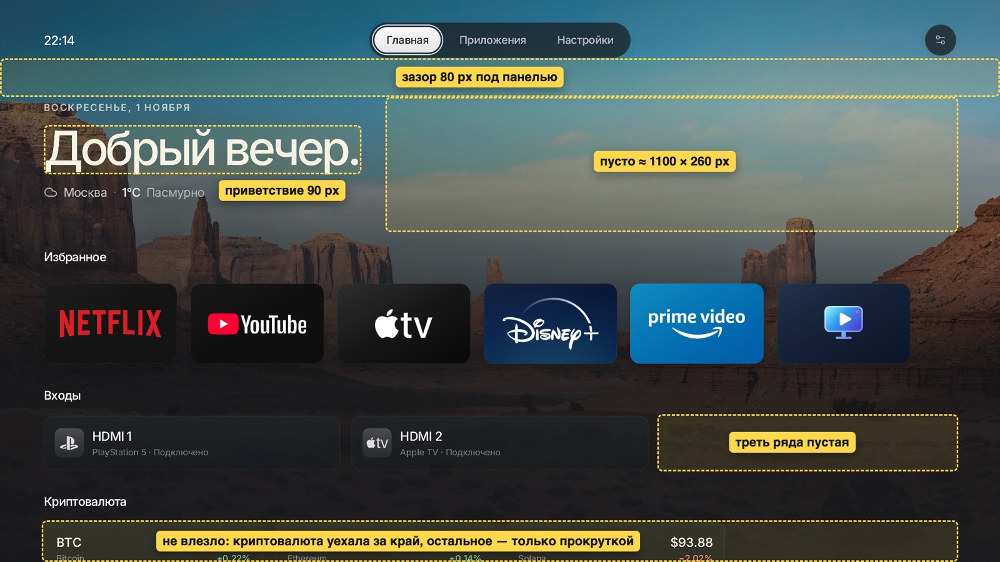
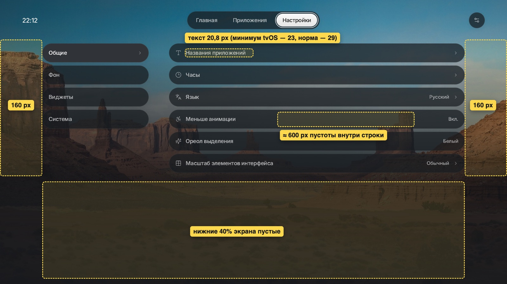
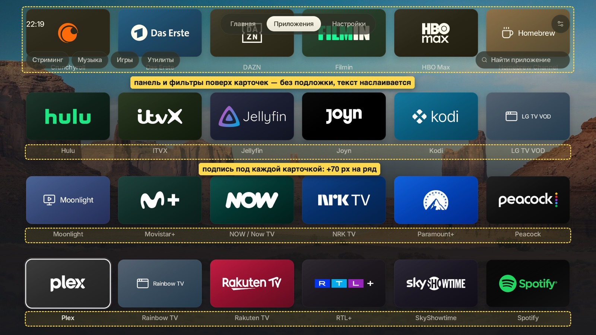
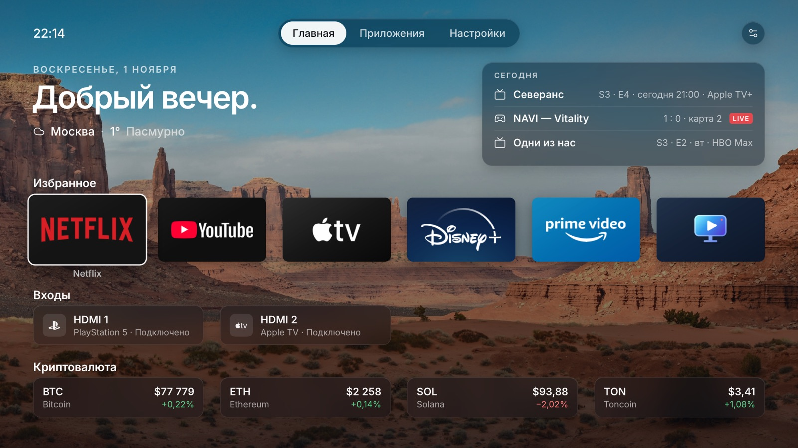
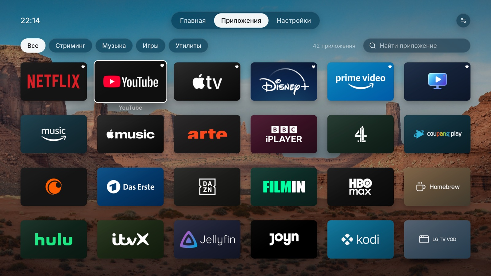
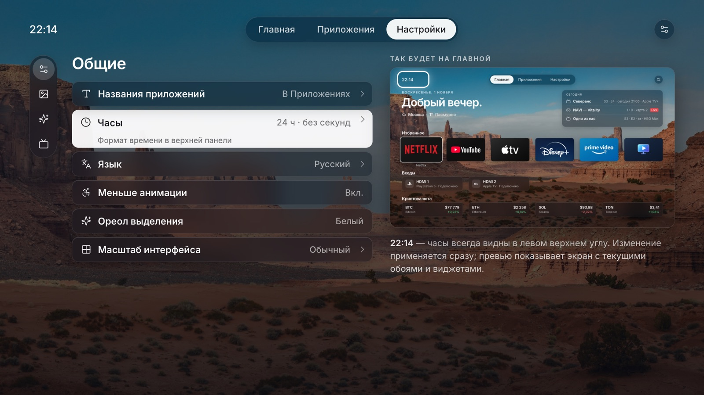
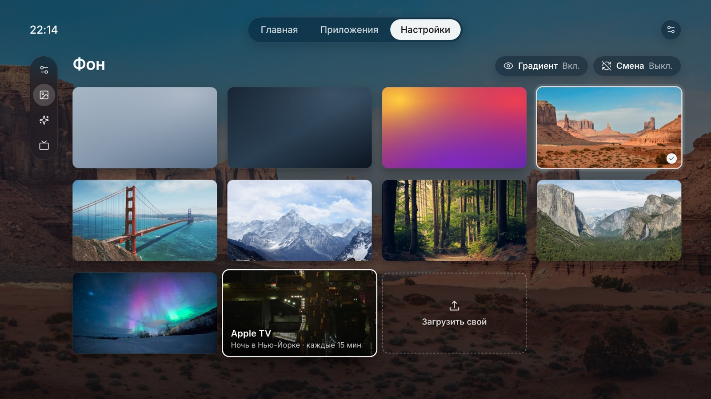

# Luma: компоновка экрана по мотивам tvOS 26

Дизайн-документ, 1 ноября 2026. Только для форка (`integration`); в upstream это не предлагается.

## Зачем

Запрос: «посмотри в целом на UX/UI tvOS 26, посмотри на наш дизайн, подготовь дизайн-документ, как бы ты
оформил интерфейс. Я не совсем разделяю видение автора оригинала: как по мне, мы тратим много полезного
экрана вникуда».

Цель — чтобы всё, что человек включил на Главной, помещалось на один экран без прокрутки, а пустое место
было только там, где оно задумано (обои), а не случайно (широкие плашки, двойные отступы, текст на
пол-экрана). Одновременно текст должен стать крупнее, а плашки — меньше: сейчас наоборот.

## Что берём у tvOS 26

Цифры — из Apple HIG (Layout, Tab bars, Typography; проверено 1.11.2026) и обзоров tvOS 26.

- **Безопасная зона: 80 px по бокам, 60 px сверху и снизу** (1 pt = 1 px при 1080p). Всё важное — внутри.
- **Сетка: колонки фиксированной ширины с зазором 40 px.** 6 колонок → 260 px, 5 → 320, 4 → 410, 3 → 560.
  1760 px полезной ширины = ровно 6 × 260 + 5 × 40.
- **Таб-бар: высота 68, верх на 46 px; уезжает вверх вместе с контентом.** Закреплён только на экранах
  с разделённым видом (настройки, библиотека). «Назад» всегда возвращает фокус на таб-бар.
- **Фокус увеличивает элемент** — зазоры между элементами рассчитаны так, чтобы увеличенный не налезал
  на соседей и подписи.
- **Подпись под иконкой — только у элемента в фокусе** (домашний экран Apple TV).
- **Текст: основной 29 pt, минимум 23 pt**; заголовки 38/48/57/76.
- **Liquid Glass (tvOS 26)** — полупрозрачное «стекло» только на хроме: верхняя панель, док, Пункт
  управления. Контент (обложки, иконки) остаётся непрозрачным. Эффект дорогой: Apple включает его только на
  Apple TV 4K 2-го и 3-го поколения. Для нас это довод в пользу дешёвой имитации, а не честного размытия.
- **Частично видимый контент у края экрана** — подсказка, что ряд продолжается; срезы с обеих сторон
  одинаковые.

## Где Luma теряет экран

Замеры на сборке `integration` (1920 × 1080, русский язык).

**Главная.** Шапка (дата, приветствие 90 px, погода) занимает левые 600 px, справа пусто ~1100 × 260 px.
Под верхней панелью зазор 80 px. Входы — две карточки по 568 px, треть ряда пустая. С включёнными
погодой, входами и криптовалютой последний ряд уже обрезан нижним краем; остальные виджеты — только
прокруткой.

**Настройки.** Поля 160 px вместо 80. Строки — пилюли на 1120 px, где между названием и значением
~600 px пустоты. В разделе «Общие» нижние 40 % экрана пустые. Текст строк — 20,8 px, описания — 15,2 px:
меньше минимума tvOS (23).

**Приложения.** Подпись под каждой карточкой добавляет ~70 px на ряд: на экране 3 ряда, 18 приложений.
При прокрутке карточки уходят под верхнюю панель и фильтры, у которых нет подложки: текст наслаивается
(видно на снимке).

**Общее.** Плашки большие, текст мелкий. До тени текст на светлых обоях (туман, облака) просто пропадал.
Тень уже сделана (коммит `c8fe059`, см. «Читаемость на обоях»).

## Принципы

1. **Одна рамка на всех экранах:** безопасная зона 80/60, сетка 260/40. Галерея фонов — 4 колонки.
2. **Хром уступает контенту.** Не больше одной строки хрома над контентом; при прокрутке она уезжает или
   получает подложку — никогда не просто висит поверх.
3. **Плотность через фокус.** Подписи и описания появляются у элемента в фокусе, а не у всех сразу.
4. **Пустота — только обои.** Пустое место допустимо, если там видна картинка; пустота внутри плашек и
   между колонками — нет.
5. **Текст крупнее, плашки меньше.**

## Предложение по экранам

### Главная

- **Верхняя панель** — как сейчас по месту (верх 46, высота 68, совпадает с tvOS); часы слева, вкладки по
  центру, кнопка настроек ТВ справа. Контент начинается с y = 150 (было ~190).
- **Шапка, y 150–400, две колонки:**
  - слева — дата (капс 22 px), приветствие 76 px (было 90), строка погоды 28 px;
  - справа (x 1160–1840) — карточка **«Сегодня»** на стекле: до трёх строк из уже существующих виджетов —
    живой матч CS2, серии на сегодня/завтра (TVmaze), при `crypto_beside` — криптовалюта. Порядок: live →
    по времени. Не влезло — уходит в свой ряд ниже. Это обобщение нынешнего «блока рядом с приветствием»
    у криптовалюты.
  - Высота шапки фиксированная (моё решение): ряд «Избранное» всегда на одном месте, есть «Сегодня» или
    нет. Без карточки справа просто видны обои.
- **Избранное:** заголовок 28 px, карточки 260 × 150 по сетке (6 на экране), дальше карусель с одинаковым
  срезом у краёв, как сейчас. Подпись — только у карточки в фокусе (если «Названия на Главной» включены).
- **Входы:** чипы 410 × 96 (4 колонки) вместо 568 × 102.
- **Криптовалюта / Сериалы / CS2:** ряды чипов 410 × 96 или карточек 260 по той же сетке.
- **Результат** при конфигурации погода + 6 избранных + 2 входа + 4 монеты + сериалы и CS2 в «Сегодня»:
  всё на одном экране, нижний край ~1006 px, ничего не обрезано.
- **Фокус:** вверх из Избранного → строки «Сегодня» (если у них есть действие) → панель. Вниз — по рядам.
- **Если контент всё же не влез:** панель уезжает вверх, когда фокус уходит ниже первого ряда, и
  возвращается по «вверх» на первом ряду или по «Назад».

### Приложения

- Фильтры и поиск — одна строка на y = 150 (как сейчас), плюс фильтр «Все» и счётчик приложений (моё
  решение, необязательно).
- Сетка 6 × 260 × 150, шаг рядов 206. **Подписи только у карточки в фокусе** — новый режим «Названия:
  при фокусе», по умолчанию. Нынешние «всегда» и «нет» остаются.
- **На экране 4 ряда = 24 приложения** (было 18, +33 %). При прокрутке панель и фильтры уезжают вверх
  (tvOS), сетка занимает y 60–1020, внизу виден срез следующего ряда.
- Если панель остаётся, у неё должна быть подложка (стекло, см. «Материалы»), а не голый текст поверх
  карточек.

### Настройки

- Панель закреплена (как у split view в tvOS).
- **Сайдбар сворачивается в колонку иконок** (76 px), когда фокус уходит в список; разворачивается
  (360 px, иконка + название), когда фокус возвращается. Название раздела — заголовком 44 px над списком.
- **Список** x 196–1016 (820 px): строки 68 px, текст 26 px, значение 24 px сразу у правого края списка,
  а не через весь экран. У строки в фокусе описание (22 px) прямо в ней; строка вырастает до 104 px.
- **Справа — живое превью Главной** (776 × 437, масштаб ~0,4): показывает результат настройки в фокусе и
  подсвечивает затронутое место (часы, приветствие, виджет). Под превью — пара строк пояснения. Для раздела
  «Система» вместо превью — сводка: версия Luma, статус обновлений, версия webOS, IP, свободное место
  (из того, что уже есть в разделе).
- Подстраницы (Часы, Погода…) открываются на месте списка, с заголовком-путём «Виджеты › Погода»; сайдбар
  и превью остаются.

### Галерея фонов

- Превью здесь не нужно: настоящий фон и есть превью. Список и правая колонка отдаются под сетку
  x 196–1840.
- **4 колонки 390 × 219**, зазор 28/32. На экране 12 плиток (было 9, и они были меньше: 360 × 202).
- «Градиент» и «Смена» — в строке заголовка справа, закреплены; сетка прокручивается под ними с маской,
  а не поверх. «Загрузить» — последней плиткой с пунктиром.
- Плитка Apple TV — как сделано: название места и «каждые 15 мин».

### Оверлеи

Опции карточки, удаление, клавиатура — без изменений по устройству. По стилю — та же стеклянная подложка,
что у хрома.

## Типографика и размеры

Шрифт тот же — Inter / Inter Display. У Inter высокий x-height, поэтому 26 px Inter читается примерно как
28–29 pt SF; отсюда значения чуть ниже tvOS.

| Роль | Сейчас | Предлагаю |
|---|---|---|
| Приветствие | 90,4 / 500 | 76 / 600 Display |
| Заголовок страницы | — | 44 / 600 Display |
| Заголовок ряда | 23,2 / 550 | 28 / 600 |
| Основной текст (строки, чипы) | 20,8 / 550 | 26 / 550 |
| Вторичный (значения) | ~18 | 24 / 450, 62 % |
| Описания, подписи | 15,2 | 22 / 450 |
| Надстрочник (дата) | 18,4 / 600 капс | 22 / 600 капс |
| Вкладки | ~20 | 25 / 500 |

Отступы: безопасная зона 80/60; заголовок ряда → карточки 16; между рядами 48; радиус карточек 14,
панелей 18–24. «Масштаб элементов интерфейса» (`ui_scale`) масштабирует эти значения, как сейчас.

## Материалы

**Стекло без размытия в кадре.** На webOS честное размытие каждый кадр не годится (Luma уже подвисала на
тяжёлых эффектах). Вместо этого при установке обоев делается одна размытая копия 480 × 270 (рядом с
нынешними затемнённой и миниатюрой). Панель рисует эту текстуру в своей скруглённой области
(координаты = экранные), сверху — тонировка `rgba(18,22,30,.46)`, рамка 1 px `rgba(255,255,255,.10)`,
блик сверху 1 px `rgba(255,255,255,.16)`. Это один дополнительный текстурный прямоугольник на панель.
При смене обоев с переходом смешиваются и две размытые копии. Для динамических обоев и Apple TV копия
делается на каждый кадр/снимок, один раз.

Где стекло: верхняя панель, свёрнутый сайдбар, «Сегодня», чипы входов и криптовалюты, кнопки действий,
оверлеи. Карточки приложений остаются как есть.

## Читаемость на обоях

Проверено на 8 снимках Apple (туман, облака, ледник, дюны, медузы, космос, закат, ночной город) — уже на
текущей сборке:

- **С градиентом** (по умолчанию) приветствие читалось везде; слабые места — мелкий серый текст (дата,
  погода) на тумане и дюнах.
- **Без градиента** на светлых снимках (туман, облака) шапка пропадала полностью.

Сделано (коммит `c8fe059`): весь текст прямо на обоях (часы, дата, приветствие, погода, заголовки рядов,
подписи приложений, подписи источников, криптоблок без карточки) отбрасывает мягкую тень. Тень — тот же
закэшированный текст, нарисованный тёмным с малой прозрачностью на кольцах ниже; крупный текст — широкая
мягкая тень (31 проход), средний — плотная (9), мелкий — узкая (7), чтобы не размывать буквы. Такой текст
рисуется непрозрачным серым того же тона, иначе тень просвечивает сквозь буквы. Иконка погоды — так же.

Для нового макета правило: **текст на обоях — всегда с тенью; на стекле — без.**

## Чего не делаем

- Не трогаем арт карточек, логотипы, модель навигации пультом, языки.
- Не добавляем новых виджетов: «Сегодня» только переселяет существующие.
- Не делаем upstream PR: upstream хочет простые отдельные PR по виджетам, без сеток и тем.

## Анти-цели (провал, даже если «работает»)

- Тормоза или подвисания на ТВ: никакого покадрового размытия и видео.
- Каша: реклама, рекомендации, больше информации, чем включил человек.
- Карточки уже 260 px — логотипы перестают читаться с дивана.
- Важное спрятано за фокусом: часы, погода, статус входов видны всегда.

## Порядок внедрения

Каждый шаг — отдельная сборка на ТВ, проверку делаешь ты.

1. **Рамка и текст:** константы безопасной зоны и сетки, шкала шрифтов, поля Настроек 160 → 80.
2. **Главная:** шапка 76 px, карточка «Сегодня», чипы входов 410, ряды по сетке, правило «всё на одном
   экране».
3. **Приложения:** режим «Названия при фокусе», шаг 206, уезжающая панель или подложка.
4. **Настройки:** сворачивающийся сайдбар, список 820, превью справа, галерея 4 × 390.
5. **Стекло:** размытая копия обоев и общий стиль панели.

## Что остаётся исполнителю

- Кривые и длительность анимаций (сайдбар, уезжающая панель); при «Меньше анимации» — мгновенно.
- Как рисовать превью: проще всего — снимок Главной во внеэкранный буфер при изменении настройки и
  масштабированная текстура; не чаще одного раза на изменение, кадры не должны проседать.
- Длинные строки (немецкий, русский): уже есть `fit_text`, правило — сначала ужимать, потом в две строки.
- Что именно показывать в «Сегодня» при пустых данных (скрыть карточку целиком — моё предложение).

## Решения, принятые мной (проверь)

- Вкладки Главная / Приложения остаются раздельными; объединять в один экран, как у tvOS, не предлагаю.
- Часы всегда видны в панели (у tvOS часов нет).
- Высота шапки на Главной фиксированная.
- «Названия при фокусе» — режим по умолчанию.
- Фильтр «Все» и счётчик на странице Приложений.
- Размеры текста чуть ниже tvOS из-за метрик Inter.

## Открытый вопрос

Карточка «Сегодня» справа от приветствия: собрать туда живые матчи и ближайшие серии (как в макете), или
оставить правую часть шапки под один виджет на выбор (как нынешний криптоблок)?
