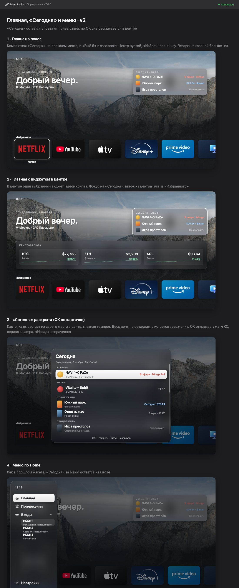

# Luma: боковое меню и новая Главная

Дизайн-документ, 3 ноября 2026. Только для форка (`integration`); в upstream это не предлагается.
Продолжает [компоновку по мотивам tvOS 26](2026-11-01-tv-layout-design.md): стекло, шрифты и сетка оттуда.

## Зачем

Запрос: «Главная, Приложения, Настройки, Входы располагаем по вертикали слева, слева будет всплывающая
менюшка с анимацией, по кнопке Home открывается это всплывающее меню, а после нажатия открывается конкретная
страница, в случае входов — в меню доп. выпадающий список с входами, чутка освободится место на экране,
потом карусель на главной с избранными перемещаем вниз, а по центру уже можем активировать какой-то из
доступных виджетов».

Цель: верхняя панель вкладок и ряд входов уходят с экрана, и Главная становится спокойной. Сверху остаются
приветствие и «Сегодня», внизу «Избранное», а в центре либо пусто, либо один виджет, выбранный человеком.

## Что решил пользователь

- **Меню слева, полностью скрыто**, полоски у края нет. Оно выезжает с анимацией.
- **Пункты:** Главная, Приложения, Входы, Настройки. «Входы» раскрываются в меню списком входов.
- **Кнопка Home открывает меню**: и когда Luma на экране, и из другого приложения.
- **«Влево» с крайнего левого элемента** карусели приложений или виджета тоже открывает меню.
- **Верх Главной:** часы, дата, приветствие и погода, всё слева.
- **«Сегодня» остаётся на своём месте**, справа от приветствия: компактная, с «Ещё N» в заголовке.
  - OK по ней раскрывает её в центре: весь день по разделам, список листается.
  - OK по строке её открывает: матч КС, сериал в Lampa.
  - «Назад» сворачивает.
- **В центре Главной** либо пусто, либо один активный виджет: крипта, CS2 или сериалы.
- **«Избранное»** переезжает вниз экрана.
- Макеты выше согласованы («Отлично»).

## Мои решения (поправимы)

- **Настройки ТВ.** Шестерёнка справа вверху становится пунктом «Настройки ТВ» внизу меню, под «Настройками».
  «Настройки» тоже внизу, отдельно от страниц.
- **Открытие «влево».** Меню открывается по «влево» везде, где левее нет элемента: первый элемент
  «Избранного», «Сегодня», виджет в центре, первый столбец Приложений, боковая панель Настроек.
- **Фокус при открытии** стоит на пункте текущей страницы. Home из другого приложения возвращает на
  Главную, как сейчас, и сразу открывает меню с фокусом на «Главной».
- **Повторный Home, «Назад» и «вправо»** закрывают меню.
- **Входы.**
  - По умолчанию список свёрнут; OK по «Входам» его раскрывает и сворачивает.
  - OK по входу переключает ТВ на него и закрывает меню.
  - Настройки входов (имя, режим, видимость) остаются в Настройках › Входы.
  - В меню показаны те же входы, что сейчас на Главной.
- **Анимация.**
  - Меню выезжает за 0,25 с (ease-out) и уезжает за 0,2 с.
  - Страница за ним темнеет до 50 % и сдвигается вправо на 56 px.
  - Со включённым «Меньше движения» меню появляется и исчезает сразу.
- **Виджет в центре** выбирается там же, где сейчас место виджета: Настройки › Виджеты › «Место».
  - Варианты: «В «Сегодня»» и «В центре» (сейчас «Отдельным рядом»).
  - В центре может быть только один виджет. Выбор «В центре» у одного переводит прежний центральный в «Сегодня».
  - Если в сохранённых настройках вне «Сегодня» стоят несколько виджетов, в центр идёт первый по порядку
    CS2 → крипта → сериалы, остальные показываются в «Сегодня».
- **Сериалы в центре** рисуются меньшими постерами, чтобы ряд влез в центр.
- **Главная больше не прокручивается** по вертикали: всё помещается на один экран.
- **Часы** остаются слева вверху на всех страницах.
- **Magic Remote.** С указкой меню открывается кнопкой Home. Зоны у левого края в этой версии нет.
  - Клик по пункту меню работает как OK.
  - Клик мимо панели закрывает меню.
- **Home поверх окна** (опции, клавиатура, матч, «Недавние»): окно закрывается, набранный текст
  сохраняется, открывается меню.
- **«Назад» с верха страницы** (боковая панель Настроек, поиск в Приложениях) ведёт на Главную, как сейчас
  «Назад» с не-Главной страницы. «Вверх» больше никуда не ведёт: вкладок нет.

## Компоновка Главной (1920 × 1080)

- **Шапка** на прежнем месте, от `CONTENT_TOP` (150) до `HEADER_BOTTOM` (400). Слева дата, приветствие и
  погода, справа «Сегодня» (x 1160, ширина 680).
- **«Избранное».** Низ карточек на 60 px выше низа экрана, под ними место для подписи фокусной карточки.
  - Карточки 260 × 150 с шагом 300, как сейчас.
  - Заголовок ряда на 50 px выше карточек.
- **Центр** — между шапкой и заголовком «Избранного». Виджет стоит рядом с заголовком, по вертикали по
  центру этого промежутка.
- **Фокус между рядами:**
  - вверх из «Избранного» ведёт в центральный виджет, если он есть, иначе в «Сегодня»;
  - вверх из центра ведёт в «Сегодня»;
  - вниз ведёт обратно.

## Меню

- **Панель:** стекло, x 32, y 32, 430 × 1016, радиус 36.
  - Сверху часы.
  - Дальше пункты высотой 76 со скруглением 20.
  - Пункт в фокусе — белая плашка с тёмным текстом, как активная вкладка сейчас.
  - У пунктов иконки: дом, сетка, вход, шестерёнка, ТВ.
- **Входы под пунктом «Входы»:** строки 64 px, сдвинутые на ширину иконки. В строке имя входа и вторая строка
  статуса, как на карточке входа сейчас.
- **Навигация в меню:** вверх и вниз по пунктам, по кругу не ходит. OK выполняет пункт.
- **Открытое меню модально:** страница за ним не получает фокус и нажатия.

## «Сегодня» раскрытая

- **Панель:** стекло, 1100 × 860 по центру экрана (x 410, y 110), радиус 34. Главная за ней затемнена.
- **Шапка панели:** заголовок «Сегодня» и строка «день недели, дата · N событий».
- **Разделы** — в порядке, в каком строки идут сейчас, пустые не показываются:
  - В эфире (матчи в эфире);
  - Матчи (предстоящие матчи);
  - Новые серии (TVmaze и Lampa);
  - Продолжить (Lampa);
  - Цены (крипта).
- **Строки** высотой 84: постер или логотип, название, вторая строка, справа время или статус.
- **Строка в фокусе** — белая плашка.
- **Прокрутка:**
  - список прокручивается за фокусом;
  - внизу затухание;
  - справа полоса прокрутки;
  - внизу подсказка «OK — открыть · Назад — свернуть».
- **Открытие и возврат:**
  - матч КС открывается окном матча, как сейчас;
  - сериал TVmaze открывается его карточкой;
  - Lampa открывается как сейчас;
  - «Назад» из окна матча возвращает в раскрытую «Сегодня» на ту же строку.
- **Анимация:** панель вырастает из компактной карточки за 0,25 с. Со включённым «Меньше движения» она
  появляется плавным переходом.
- **Компактная карточка:**
  - становится одним элементом фокуса, строки в ней больше не выбираются по отдельности;
  - в фокусе у неё обводка, как у других карточек;
  - если строк нет, карточки нет, как сейчас.

## Порядок внедрения

1. **Меню вместо вкладок.**
   - Верхняя панель и шестерёнка убираются; появляется меню.
   - Home и запуск из другого приложения открывают меню.
   - Меню открывается по «влево» с края; в нём входы и Настройки ТВ.
2. **Главная.**
   - «Избранное» переезжает вниз; ряд входов и лишние ряды виджетов убираются.
   - Появляется виджет в центре и место «В центре» в настройках.
   - Вертикальная прокрутка Главной убирается.
3. **«Сегодня».** Компактная карточка становится одним элементом фокуса, по OK раскрывается в центре.

После каждой фазы: тесты (`cargo test --bin luma`), clippy, сборка и установка на ТВ. Проверяет пользователь.

## Не делаем

- Предложения в upstream.
- Новые виджеты.
- Зону у края экрана для указки.
- Изменения компоновки Приложений и Настроек сверх удаления вкладок. Их верх остаётся, где был.
