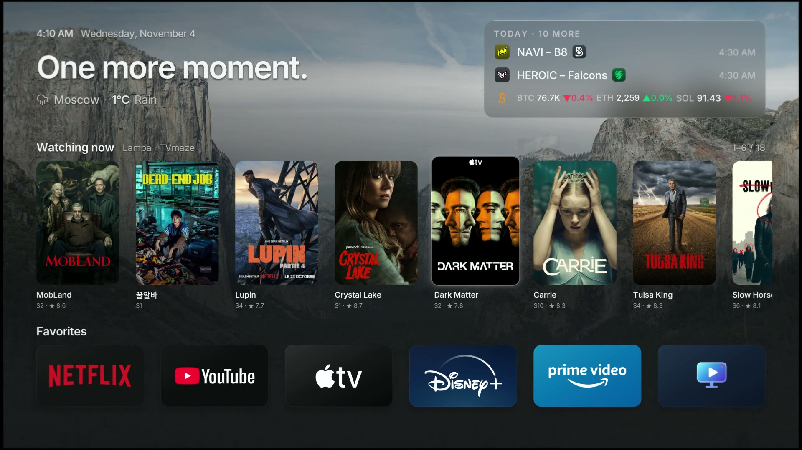
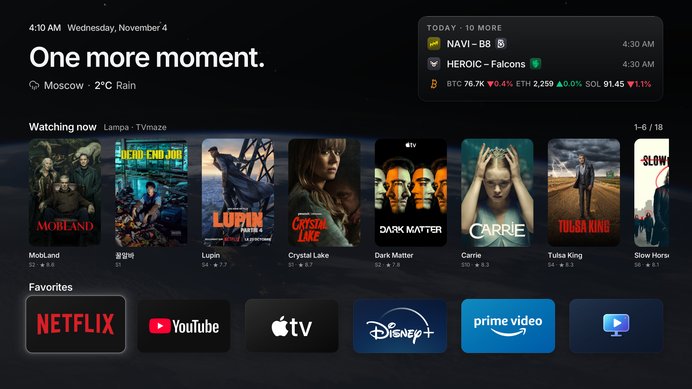
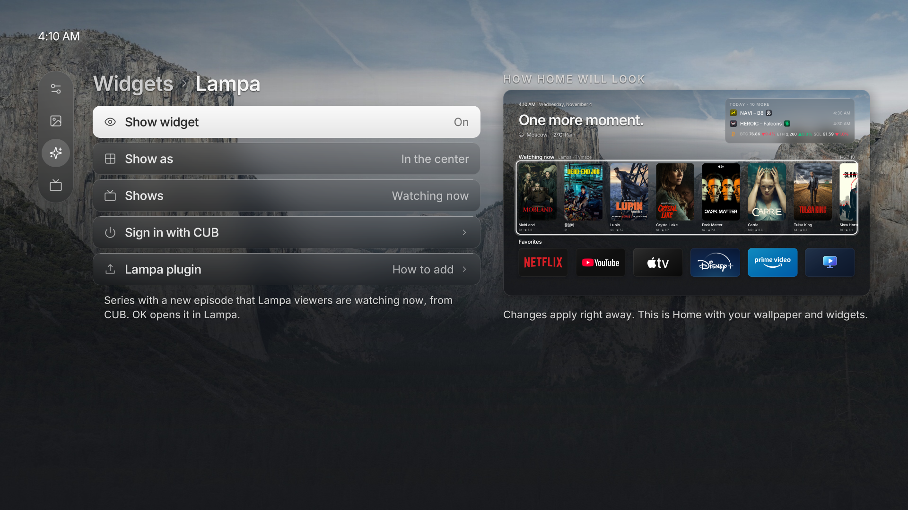

# LG Luma+

A remote-first launcher for rooted LG webOS TVs, inspired by Apple TV. Luma+ is built on
[Luma](https://github.com/ecklf/lg-luma) by ecklf and adds a Today card, Lampa, CS2 and crypto
widgets, and a tvOS-style layout.

<!-- The film: docs/luma-preview.mp4. Upload it in GitHub's README editor and put the
     user-attachments link here so it plays inline. -->
[](docs/luma-preview.mp4)

<details>
<summary>Screenshots</summary>

<table>
  <tr>
    <td width="50%" align="center">
      
    </td>
    <td width="50%" align="center">
      
    </td>
  </tr>
  <tr>
    <td width="50%" align="center">
      
    </td>
    <td width="50%" align="center">
      
    </td>
  </tr>
</table>

</details>

## What Luma+ adds

- **Today card.** Beside the greeting: live and upcoming CS2 matches, new episodes and coin
  prices at a glance. OK opens it, with a tab for each widget.
- **Home your way.** Today with a CS2 or Lampa row in the center, Today alone, or Clean: just
  the clock, the greeting and your favorites over the wallpaper.
- **Lampa.** A row of posters: what Lampa viewers are watching now, or your own Continue watching
  from your CUB account (sign in with a QR code). OK opens the series or film right in Lampa,
  through a small Lampa plugin. Outside Russian, series show their English posters from
  [TVmaze](https://www.tvmaze.com).
- **CS2 Score.** Counter-Strike 2 matches from Liquipedia with team logos, live scores and
  results, and a match dialog with maps, rounds and lineups.
- **Crypto prices.** Up to four coins, from the usual eight or any Binance coin, with their own
  marks, in the Today card or beside the greeting.
- **A tvOS-style screen.** A side menu instead of the tab bar, glass panels, a softer focus, and
  Interface scale for the clock, names and cards.
- **Settings with a live preview** of Home that follows every change.
- **Wallpapers.** Apple TV's aerial stills, changing every fifteen minutes, and dynamic
  wallpapers that follow the sun at your weather location.
- **TV conveniences.** AirPlay as an input, Close all in the app switcher, faster running-app
  switching, **System › Luma+ as Home screen** to take over the Home button from Settings, and
  automatic updates for Homebrew apps.
- **Faster text on the TV** (a glyph atlas), weather details and place names in your language.

Luma+ has its own app ID, `com.eluz1ve.lumaplus`, so it installs beside Luma and keeps its own
settings. It updates from this repository's releases.

## Compatibility

> [!NOTE]
> Luma+ should start on any TV running webOS 4 or newer. The following configurations have been
> confirmed to work with Luma by its community. Home takeover support varies, as noted below:

<details>
<summary>webOS 4</summary>

| TV        | Model identifier | Takeover Support |
| --------- | ---------------- | ---------------- |
| LG C8     | `OLED??C8*`      | ❌               |
| LG C9     | `OLED65C97LA`    | Unknown          |
| LG UM7450 | `UM74507LA`      | ❌               |

</details>

<details>
<summary>webOS 5</summary>

| TV        | Model identifier | Takeover Support |
| --------- | ---------------- | ---------------- |
| LG UN7100 | `49UN71006LB`    | ✅               |

</details>

<details>
<summary>webOS 6</summary>

| TV        | Model identifier | Takeover Support |
| --------- | ---------------- | ---------------- |
| LG C1     | `OLED48C1KNB`    | ✅               |
| LG UP8000 | `86UP80009LA`    | Unknown          |

</details>

<details>
<summary>webOS 24</summary>

| TV    | Model identifier | Takeover Support |
| ----- | ---------------- | ---------------- |
| LG B2 | `OLED65B29LA`    | ✅               |

</details>

<details>
<summary>webOS 25</summary>

| TV        | Model identifier | Takeover Support |
| --------- | ---------------- | ---------------- |
| LG B5     | `OLED77B5PUA`    | ✅               |
| LG C2     | `OLED42C2PSA`    | ✅               |
| LG C2     | `OLED65C2*`      | Unknown          |
| LG C2     | `OLED77C2*`      | Unknown          |
| LG C4     | `OLED42C4*`      | ✅               |
| LG G3     | `OLED??G3*`      | Unknown          |
| LG NANO77 | `55NANO776RA`    | ✅               |
| LG QNED86 | `55QNED86T6A`    | Unknown          |
| LG UT8050 | `50UT8050*`      | ✅               |

</details>

<details>
<summary>webOS 26</summary>

| TV    | Model identifier      | Takeover Support |
| ----- | --------------------- | ---------------- |
| LG C2 | `OLED65C2PSA`         | ✅               |
| LG C3 | `OLED65C31LA`         | ✅               |
| LG C3 | `OLED65C36LC`         | ✅               |
| LG C5 | `OLED55C57LA`         | ✅               |
| LG C5 | `OLED55C5PSA`         | Unknown          |
| LG C6 | `OLED65C6*`           | Unknown          |
| LG C6 | `OLED77C6*`           | ✅               |
| LG G5 | `OLED83G5WUA.BUSYDJR` | ✅               |
| LG G5 | `OLED77G5WUA.DUSQLJR` | ✅               |

</details>

## Installation

### Homebrew Channel

Add this repository in Homebrew Channel's settings:

```text
https://github.com/eluz1ve/lg-luma-plus/releases/latest/download/repo.json
```

Or download the IPK from [Releases](https://github.com/eluz1ve/lg-luma-plus/releases) and install
it with [webOS Dev Manager](https://github.com/webosbrew/dev-manager-desktop).

### SSH

On your computer, replace `TV_IP`:

```sh
scp -O dist/com.eluz1ve.lumaplus_1.0.0_arm.ipk root@TV_IP:/tmp/luma-plus.ipk
ssh root@TV_IP
```

In the TV's root shell:

```sh
luna-send -i luna://com.webos.appInstallService/dev/install \
  '{"id":"com.eluz1ve.lumaplus","ipkUrl":"/tmp/luma-plus.ipk","subscribe":true}'
```

### Lampa plugin

Lampa on webOS ignores links from other apps, so without help OK on a Lampa card only opens
Lampa's home. Add the plugin once, in Lampa: **Settings → Extensions → Add plugin**, enter

```text
https://cdn.jsdelivr.net/gh/eluz1ve/lg-luma-plus@main/lampa/luma.js
```

and restart Lampa. Luma+ shows the same address with a QR code in
**Settings → Widgets → Lampa → Lampa plugin**.

## Replacing LG Home

### Takeover Method

> [!NOTE]
> Takeover is supported on **webOS 5, 6, 25 and 26**.\
> The takeover does not delete LG Home: it remains underneath a temporary mount, which is cleared by
> a reboot. If Luma+ is uninstalled first, LG Home returns on reboot, but the separate takeover boot
> hook remains and logs an error because it can no longer find Luma+. No TV reset is needed. For
> clean removal, disable takeover before uninstalling.

Install Luma+ and verify that it opens normally. Disable any Home-button mapping in
[LG Input Hook](https://github.com/Simon34545/lginputhook) (remove its Home-key action) and any
other Home replacement, then run in the TV's root SSH shell:

If you enabled Luma+'s autostart method earlier, disable it first:

```sh
APP=/media/developer/apps/usr/palm/applications/com.eluz1ve.lumaplus
sh "$APP/autostart.sh" disable
```

To enable the takeover run:

```sh
APP=/media/developer/apps/usr/palm/applications/com.eluz1ve.lumaplus
sh "$APP/home.sh" enable
```

To see the status or disable the home override use:

```sh
sh /var/lib/luma-home/home.sh status
sh /var/lib/luma-home/home.sh disable
```

`restore` is an alias for `disable`.

Boot log: `/var/lib/luma-home/boot.log`. See the
[development guide](development.md#optional-native-home-integration) for implementation details.

<details>
<summary>Method for webOS 5 / 6</summary>

On **webOS 5 and 6**, SAM cannot reread a mounted Home manifest, so `home.sh enable` instead
bind-mounts Luma+'s executable over LG's `/usr/bin/com.webos.app.home`. LG's Home manifest stays
in place and Luma+ registers with SAM itself, so the Home key brings the running Luma+ back instead
of restarting it. The commands and the cold-boot hook are the same.

</details>

<details>
<summary>Method for webOS 25 / 26</summary>

Mounts Luma+ over the system Home app and reapplies the mount at cold boot. The LG splash
shown before Luma+'s window opens is the wallpaper you selected in **Settings → Background**, staged
from the saved preferences at each boot. Normal app launches also use your selected wallpaper:
Luma+ updates the launch splash through Homebrew Channel's root service after loading or saving your
settings. Open Luma+ once after installing or updating so subsequent launches use your saved background.
LG Home's original files remain underneath, using the same approach as
[Glasshouse Home](https://github.com/rorygallagher2024/glasshouse/blob/main/server/lib/home-takeover.js).

</details>

### Autostart Method

Open Luma+ 25 seconds after a full cold boot. Run in the TV's root SSH shell:

```sh
sh /media/developer/apps/usr/palm/applications/com.eluz1ve.lumaplus/autostart.sh enable
```

Use this when takeover is disabled. It launches Luma+ as a regular app and does not remap the Home button.

Disable before enabling takeover or uninstalling Luma+:

```sh
sh /media/developer/apps/usr/palm/applications/com.eluz1ve.lumaplus/autostart.sh disable
```

### LG Input Hook Method

You can use [LG Input Hook](https://repo.webosbrew.org/apps/org.webosbrew.inputhook/), configure an Execute action with this one-line command:

```sh
/usr/bin/luna-send -n 1 -w 5000 luna://com.webos.service.applicationmanager/launch '{"id":"com.eluz1ve.lumaplus"}'
```

Test on a spare button first. Disable the mapping in Input Hook to restore normal Home behavior.

## Features

### Backgrounds

Open **Settings → Background → Upload**, then scan the QR code or open the shown
address on a phone or computer on the same network. Choose a JPEG, PNG or WebP and adjust
its 16:9 crop before choosing **Save to TV**.

The upload link works only while its TV dialog is open and focused.

Enable **Rotation** beside **Upload** to cycle through backgrounds on each Luma+ restart and every
15 minutes with a slow cross-fade. Rotation is off by default and leaves your manually chosen
LG splash unchanged.

Toggle **Gradient** beside **Rotation** to turn background shading on or off. It defaults to On
and remembers your choice. Older uploads without an unshaded copy keep their full-resolution
shaded image. This does not change LG's launch splash.

### Recent app switching

Press **Back** on Home, or hold **Back** for 0.6 seconds from any page, to open Recent apps.

- **Left / Right**, the pointer, or the scroll wheel browses recent apps and inputs.
- **OK** or a pointer click opens the selected app or input.
- **Up** closes the selected app and removes its card.
- **Down** selects **Close all**; press **OK** to close the displayed apps one at a time.
- **Back** dismisses the switcher and restores the previous page and focus.

These shortcuts work while Luma+ is focused. From another app, return to Luma+ first.

With rooted Home integration, the switcher lists running applications and closes them directly
on its TV worker, without starting Homebrew or JavaScript for each operation. System apps and
inputs are excluded; a process shared by multiple applications is never terminated directly.
Automatically preloaded apps appear only after being opened by the user. Closing their card
does not change the TV's automatic preload settings.

### Shortcut tiles

Shortcut tiles sit on Home like apps but send a web request when selected, for example to a Home
Assistant webhook. Open **Settings → Widgets → Shortcuts → Configure** and scan
the QR code.

### Homebrew app updates

Turn on **Settings → System → Update Homebrew apps automatically** to keep apps installed through
Homebrew Channel, such as Moonlight or YouTube AdFree, current. It is off by default. When on, Luma+
compares them with [Homebrew Channel's repository](https://repo.webosbrew.org) ten minutes after
starting and then twice a day, and installs a newer version only while that app is closed and only
if the package matches the repository's checksum. A short notice names each updated app. Luma+ and
Homebrew Channel keep their own update paths and are never updated by this setting.

## Development

### Setup & Building

From the repository root, with Nix flakes enabled:

```sh
nix develop
pnpm install --frozen-lockfile
pnpm sdk
export WEBOS_NDK="$PWD/.build/toolchain/arm-webos-linux-gnueabi_sdk-buildroot"
pnpm run package
```

The first native runtime preparation also downloads a
checksum-pinned SDL-webOS library; both downloads are cached under `.build/`.

Output:

```text
dist/com.eluz1ve.lumaplus_1.0.0_arm.ipk
dist/sha256sums
dist/repo.json
dist/app-icon-large.png
```

Open [webOS Dev Manager](https://github.com/webosbrew/dev-manager-desktop), connect to the TV's
IP on port **22** as **root**, and install the IPK. Open **Luma+** from the TV menu. Homebrew
Channel must be elevated; on webOS 26 use **0.8.0-rc1 or newer** for its `lunabus.query` mapping.

The package uses **`com.eluz1ve.lumaplus`** and installs separately from Luma
(`com.ecklf.luma`). Preferences are local JSON files and are separate for each installation;
Luma's are not migrated. Homebrew Channel treats Luma+ as a separate app.

Wait for installation success; Ctrl+C closes an ongoing subscription. Fully close and reopen
Luma+ after updating. The [development guide](development.md#tv-startup-diagnostics) has a jailed
launch command that exposes errors hidden by the normal menu launch.

## Preview

```sh
nix develop
pnpm install --frozen-lockfile
pnpm assets
pnpm dev
```

The desktop preview uses sample inventory and never calls TV services. To manually exercise a
longer app grid:

```sh
pnpm dev --test-extra-apps 120
```

Preview preferences are separate from normal preferences. See [development.md](development.md)
for controls, vector rendering, diagnostics, tests and the source layout.

For release-worthy changes, add a file generated by `pnpm changeset`. The automated
Version Packages PR synchronizes app versions and publishes after merging and passing CI.
See [Releases](development.md#releases) for the workflow and repository setup.

## License

Luma+ is licensed under MIT, like [Luma](https://github.com/ecklf/lg-luma), which it is built on.\
Luma+ is not affiliated with LG, Apple, Lampa, CUB, TVmaze, Liquipedia, Binance or any other
brands shown in its UI. Series posters outside Russian come from [TVmaze](https://www.tvmaze.com)
(CC BY-SA).
